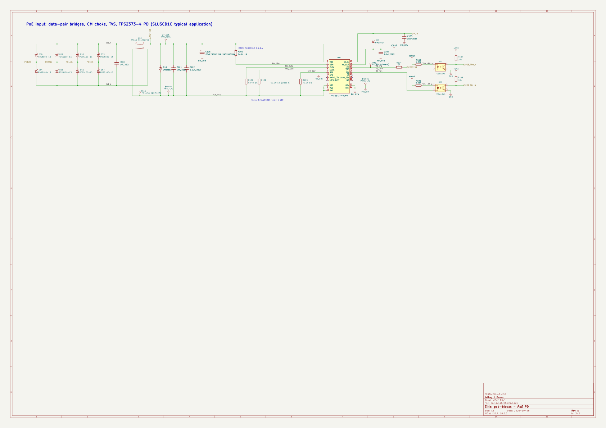
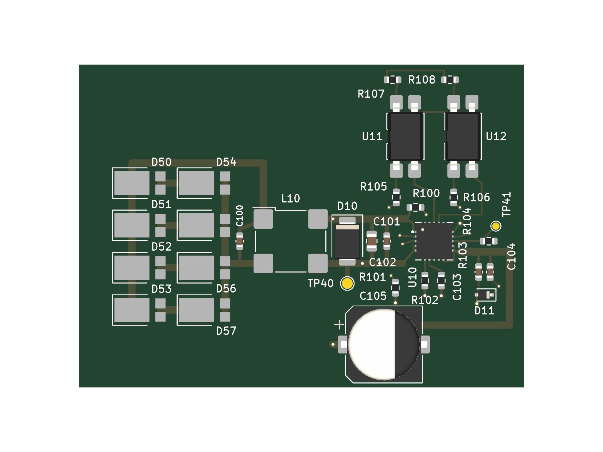

# poe_pd: IEEE 802.3bt PoE powered-device front end

## 1. Status

**Drawn and parity-checked; not yet bench-proven. No compliance certification (IEEE 802.3bt,
safety or EMC) is claimed.**

Rev B of the block (2026-11-19, Ion-Speakers#15): ADI's LT4294 + LT4321 design (DC2583A), which replaces
rev A's TPS2373-4 and Schottky bridges. Jeff picked it after rev A's TPS2373-4 came out at 94% of its
current rating at 90 W, and its Schottky bridge at 173 C on the one-pair-set bound (Ion-Speakers PR #20 and
#15). Rev B is a reviewed design, not a measured one, until [BRINGUP.md](BRINGUP.md) has rows. ADI's
DC2583A is Ethernet Alliance-certified; this block is not, and it adds a common-mode choke DC2583A
doesn't have (section 5).

The block has a 4-layer PCB layout, 54 x 40 mm (section 9). It is scripted and DRC-clean in the block's test
project, and its FET copper is sized for the 90 W worst case, even with no help from the inner layers. It hasn't
been built.

## 2. What it is

The PD side of a PoE port, from the magnetics' centre taps to the load's input:

- an **LT4321 ideal-diode bridge** (U12) with eight **PSMN040-100MSE** FETs (Q50-Q57), so 2-pair and
  4-pair PSEs work without diode drops (DC2583A uses PSMN075-100MSE; section 5 says why these);
- an input common-mode choke (Würth 744272251, L10, from TI's PMP20878) with 1 nF caps either side.
  Because the choke sits between the bridge and the controller, the LT4321 is enabled by a 24 V Zener
  from VPORT+ (D13, LT4321 Fig. 5). There's a TVS at each IC (D12 at the LT4321, D10 at the LT4294) and
  a 47 nF CPD cap at each (C103, C102);
- an **LT4294** PD controller (U10), strapped for **Class 8** (RCLS 49.9R, RCLS++ 118R: 71.3 W at the PD
  after 5 class events, LT4294 Table 2 p7). It drives a **PSMN040-100MSE high-side hot-swap FET** (Q58).
  CGATE (47 nF + 3.3k, C104/R103) sets the inrush current, and PWRGD holds the load off until inrush is done;
- the **T2P** power-grant output carried across the isolation barrier by one FOD817AS optocoupler (U11),
  its LED fed from POE_VDD through 33k (R105), with a 10k pull-up (R106) to the isolated 3.3 V;
- the output bulk cap C105 (100 uF 100 V);
- two test points on the primary side, TP40 (POE_VSS) and TP41 (PD_PWRGD), which aren't in the BOM.

Every part is rated for **continuous 90 W at the PD** (section 5a).

**There is no PD current limit.** The LT4294 has none: it limits inrush only. A short after Q58 is cleared
by the PSE's port current limit and by the load's own limit (on wallnode-amp, the UCC2897A's cycle-by-cycle
limit). A board that splits POE_VDD into several outputs must limit each output itself, with an eFuse or
similar on that board, not in this block. The planned PoE wall power jack (3.3, 5, 12 and 24 V outlets)
is the first such board (Jeff, 2026-11-18).



## 3. Interface

| Port | On the sheet | Direction | Rating | Source |
|---|---|---|---|---|
| PR12, PR36, PR45, PR78 | hierarchical label | in | Magnetics centre taps, 0 to 57 V DC between pair sets | IEEE 802.3bt PSE range; LT4321 p5 |
| POE_VDD | hierarchical label | out | **Switched +**: the hot-swap FET's source (LT4294 HSSRC). 0-57 V; up to 71.3 W at the PD at Class 8, less when the PSE grants less (section 4). Parts rated for 90 W continuous, 1.73 A (section 5a) | LT4294 p5, p8, p16 |
| POE_VSS | power symbol (global) | out | The return and the primary ground (LT4294 GND); **not switched** | LT4294 p5, p16 |
| PD_PWRGD | hierarchical label | out | Open drain to POE_VSS (100 V, 5 mA abs max): low during classification and inrush, open once the hot-swap FET is fully on. Use it to hold the load off (RUN, SS/SD) | LT4294 p2, p9 |
| POE_T2P_N | hierarchical label | out | Open collector on the isolated side, 10k to +3V3; low when T2P is low. PWM-coded grant, section 4 | LT4294 p3, p9 Table 3 |
| +3V3, GND | power symbol (global) | in | The isolated (secondary) logic supply and ground for the opto output | |

The primary side (POE_VDD, POE_VSS) is isolated from the secondary (+3V3, GND, POE_T2P_N) only through the
optocoupler (FOD817, 5000 Vrms UL1577). The 1500 Vrms barrier itself is the board's job: creepage and
clearance at layout.

**Load inrush.** IINRUSH = IGPU x CPORT / CGATE (LT4294 p8). With C105 alone that's 28-153 mA (worst-case
bounds, section 5a). Everything on POE_VDD adds to CPORT, so a board recomputes it with its own input caps:
it must stay under 350 mA for the first 80 ms (p9), and inside Q58's SOA.

On a board, the power symbols join the board's own nets of the same name, so a board that calls its
3.3 V rail something else renames them.

## 4. Power negotiation (firmware rules)

The block asks for Class 8, but the switch decides what it gets. Whatever reads POE_T2P_N (an ESP32 on
wallnode-amp) has to follow these rules: nothing in the hardware stops the load drawing more than the grant.

### What the switch granted: T2P

LT4294 Table 3 (p9), for a Class 5-8 PD (RCLS++ fitted), and Table 4 (p10):

| T2P (low-impedance share of the period) | POE_T2P_N | Granted at the PD | When |
|---|---|---|---|
| 25% | low 25%, at 690-990 Hz | 71.3 W | Type 4 PSE, 5 class events: Class 8 granted |
| 50% | low 50%, at 690-990 Hz | 51 W | 4 events: a Type 3 PSE, or a Type 4 short of budget |
| always low | always low | 25.5 W | 2-3 events: an 802.3at (Type 2) PSE, or demoted |
| always high (Hi-Z) | always high | 13 W | 1 event: a Type 1 PSE, or demoted. Also what the pin reads before power-good |

T2P is driven after PWRGD is valid (p3). The opto stretches the low time: with the 10k pull-up, its
turn-off (storage + fall) is about 80 us (FOD817 p6 Fig. 15), so a 25% duty reads up to ~33% and 50% up to
~58% (calc/poe_pd_90w.py). The firmware decodes **over at least 4 periods**, and uses these bands:

| Measured low share | Grant |
|---|---|
| under 12% | 13 W (and "not known yet") |
| 12-42% | 71.3 W |
| 42-80% | 51 W |
| over 80% | 25.5 W |

It also checks that the period is 0.9-1.6 ms when it's toggling (690-990 Hz, plus margin). Anything else,
or two decodes that disagree, counts as the lowest grant.

Firmware rule:
1. Boot with the amp muted, or with its limiter at the idle tier.
2. Decode POE_T2P_N twice, a few periods apart, and use the grant only when both decodes agree.
3. Set the amp limiter so the whole board stays under the granted power (minus the board's own
   draw, converter losses included), then unmute (after the stagger below).
4. Keep decoding. If the grant drops, cut the limiter at once; if it rises, ramp up.

### Asking for less, then more: LLDP

After boot, the ESP32 uses 802.3bt Data Link Layer classification (LLDP) to ask the switch for
only what it needs, for example the idle tier, and asks again for more, up to the Class 8 ceiling,
when the music needs it. That frees switch budget for the other ports.

Checked against IEEE 802.3bt task force text (the published IEEE 802.3 standard itself is
paywalled and wasn't read):
- The request goes in the IEEE 802.3 Power via MDI TLV (an LLDP TLV, IEEE 802.3 Clause 79): the
  PD sends "PD requested power value" and the switch answers with "PSE allocated power value". Both
  are the maximum average input power at the PD's connector, in 0.1 W steps
  ([LLDP ad hoc baseline, 79.3.2.5-79.3.2.6](https://grouper.ieee.org/groups/802/3/bt/public/lldpadhoc/Baseline_for_review-LLDP_adhoc_Rev001.pdf)).
- Once DLL classification succeeds it takes precedence over the hardware class, and the assigned
  class follows the allocated value (621-999, that is 62.1-99.9 W, is Class 8). But "the Physical
  Layer classification of the PD is the maximum power that the PD draws across all output voltages
  and operational modes" ([yseboodt_05_0916](https://www.ieee802.org/3/bt/public/sep16/yseboodt_05_0916_dllclasschange.pdf),
  33.2.7). So the hardware Class 8 is the ceiling: LLDP can lower the grant and raise it again up
  to 71.3 W, never above it.

Firmware rule:
1. Lower the amp limiter first, then send the lower request.
2. To go up, send the request and raise the limiter only after the switch's PSE allocated power
   value comes back at the new figure. Never above the T2P grant.
3. T2P doesn't change with LLDP: it shows the hardware grant only. The firmware keeps the LLDP
   allocation itself and limits to the smaller of the two.
4. If LLDP never answers, the hardware grant is all there is.

This needs a managed switch that supports 802.3bt LLDP power (Power via MDI). An unmanaged switch
gets the hardware class only: T2P is the whole story, and the switch usually reserves the full class
for the port. ESP-IDF has no LLDP power agent that we know of, so the firmware sends and parses the
LLDPDUs itself (EtherType 0x88CC).

### Startup stagger

After a power cut or a switch reboot every node starts at once. So, after boot, a node doesn't
take power all at once:
1. It waits a delay worked out from its own MAC address (for example a hash of the MAC, modulo a
   few seconds in fixed steps): different on every node, and the same every time on one node. It
   waits before unmuting and before asking for more power over LLDP.
2. Then it ramps the amp limiter up gradually to the grant, rather than jumping to full, so the
   switch and the other nodes can adjust. Raises over LLDP go up in steps the same way. (Jeff
   prefers the ramp to a single step.)

Many managed switches already power their ports one after another, with a per-port power-up
delay. The node's own stagger comes on top of that; it doesn't replace it.

## 5. Sources and licence check

| Source | What was used | Terms |
|---|---|---|
| ADI LT4294 data sheet, Rev B (04/19) | Pinout, Class 8 resistors, hot-swap FET and CGATE, CPD split, TVS, PWRGD, T2P coding, typical application (p16) | ADI's data sheets are published for designing in its parts; values and topology reused in an original drawing, nothing reproduced. |
| ADI LT4321 data sheet, Rev A (07/22) | Pinout, MOSFET requirements, CPD, TVS, the Zener enable with a choke (Fig. 5 p10) | Same. |
| ADI DC2583A demo manual, Rev A (11/18) | The whole PD stage: schematic (p8-9) and parts list (p6-7), including R12 8.2R, C1/C3/C5, Q1/Q3-Q10 | Same; ADI's design files aren't redistributed here. |
| Nexperia PSMN040-100MSE and PSMN075-100MSE data sheets (26 Mar 2013) | Ratings, Rds(on) vs Tj, SOA, pinning | Nexperia data sheets; nothing copied. |
| Nexperia AN90003 Rev 5.0 (12 Feb 2026), LFPAK MOSFET thermal design guide | Rth(j-a) vs copper area for the FET pours: one 2 oz layer (Fig. 25), four layers with vias (Fig. 35), two FETs side by side (Fig. 41) | Nexperia application note; read, nothing copied. |
| TI PMP20878 (TIDRRG3B) | The common-mode choke and its two 1 nF caps, kept from rev A | TI Important Notice: use for development with TI products only, no reproduction. No TI part remains in this block; nothing from TI's documents is reproduced. |
| IEEE 802.3bt task force public documents (LLDP ad hoc baseline Rev001; yseboodt_05_0916) | The LLDP power rules in section 4 | Read and summarised in our own words, with short quotes; nothing copied. Read 2026-11-12. |
| KiCad 10 stock symbols and footprints (Device, Isolator, Connector, power; Diode_SMD, Capacitor_SMD, Resistor_SMD, Inductor_SMD, Package_DIP, Package_DFN_QFN, Package_TO_SOT_SMD, TestPoint) | Symbols and footprints | CC-BY-SA-4.0 with KiCad's exception: designs that use the libraries aren't bound by the licence. |
| `pcb-blocks:LT4294`, `pcb-blocks:LT4321`, `pcb-blocks:PSMN040-100MSE`, `pcb-blocks:PSMN075-100MSE` symbols | LT4294 drawn from its p2/p5 pin table. LT4321 is KiCad's `Power_Management:LT4321xUF` with EN/~EN typed input (KiCad's has ~EN as an output) and the stacked OUTN pin split into 9 and 17 (EP), so a SKiDL netlist can match it. The PSMN parts are KiCad's `BUK9M53-60EX` LFPAK33 symbol renamed (pins 1-3 S, 4 G, 5 D, as Nexperia's pinning table) | CERN-OHL-P-2.0 with the rest of this repo (the derived symbols keep KiCad's licence exception). |

Deviations from DC2583A:
- **Common-mode choke kept** (L10 with C100/C101, from PMP20878), for conducted emissions from the load's
  converter. With it, the LT4321 is enabled by a 24 V Zener from VPORT+ to EN (LT4321 Fig. 5), not by
  PWRGD (DC2583A R18), and each IC gets its own TVS (D12, D10) and 47 nF CPD.
- **Bridge FETs PSMN040-100MSE** (DC2583A: PSMN075-100MSE; Jeff, Ion-Speakers#15, 2026-11-19). At the 1.80 A
  case the PSMN040 drops 66 mV (36.6 mohm max at 25 C, p5), inside LT4321 p8's 20-70 mV; the PSMN075 drops 128 mV
  (71 mohm). The loss halves (0.320 W vs 0.622 W per conducting FET at 175 C Rds(on)), so the copper, not the FET,
  stopped setting the block's size. Same LFPAK33 footprint, VDS and VGS(th) as PSMN075, and the **same IDSS limits**
  (1 uA at 25 C, 500 uA at 175 C, p5 of both), so detection is unchanged against ADI's design (section 5a). The cost:
  30 nC gate charge (p6) against 16.4 nC, so the gates take up to 2.0 ms to enhance at the LT4321's 15 uA minimum
  pull-up (p3), with the body diodes conducting meanwhile.
- **H-grade ICs** (LT4294HDD, LT4321HUF; 125 C) in place of DC2583A's I-grade (85 C).
- **All port MLCCs are 250 V** (DC2583A: 100 V) for the 2x rule at 57 V; CGATE sees up to 75 V.
- AUX is tied to GND (unused, LT4294 p5); DC2583A's auxiliary input, its LED and its lab-test FET (Q11) are left out.
- The class resistors are fixed for Class 8 (DC2583A has a jumper bank).
- T2P drives an optocoupler (LT4294 p16 shows "OPTO"), LED from POE_VDD through 33k.

## 5a. Ratings at 90 W

The block is rated for the worst case, not the 71.3 W IEEE PD figure: **90 W continuous at the PD**, the full
Class 8 PSE budget arriving on a short cable. The lowest Type 4 PSE port voltage is 52 V (IEEE 802.3bt; the
standard wasn't read), so the current is 90 / 52 = **1.73 A** (1.80 A at 50 V). In the bridge, **one pair
set carries all of it**. Derating is at 57 V and the air at the board is 50 C. Every FET's loss uses its
**175 C maximum Rds(on)**. The workspace section 5 rules apply. The numbers and their pages are in
[`calc/poe_pd_90w.py`](calc/poe_pd_90w.py) (output committed); the summary:

| Part | Check | Result |
|---|---|---|
| Q50-Q57 PSMN040-100MSE | 1.73 A x 98.8 mohm (36.6 x 2.7 at 175 C, p5, p8 Fig. 12) = 0.296 W (0.320 W at 50 V), two conduct; 100 V vs 57 V | 1.75x; Tj with the block's copper below |
| Q50-Q57 drop (LT4321 p8) | 1.80 A x 36.6 mohm (25 C max) | 66 mV, inside 20-70 mV |
| Detection vs FET leakage | 4 FETs reverse-biased; IDSS 1 uA at 25 C / 500 uA at 175 C (p5), exponential between, sqrt(V) below 100 V (general knowledge); slope at 2.7 V | VSIG 23.7-25.2k (LT4294 p3): -0.8 % at 50 C air; 21.6k worst, re-detecting at 110 C right after a 90 W port drop, inside the 19-26.5k a PSE accepts and the same as with ADI's PSMN075 |
| Q58 PSMN040-100MSE | 36.6 mohm x 2.7 (Fig. 12) = 98.8 mohm: 0.30 W; 1.73 A vs 21 A at Tmb 100 C | 8% |
| Inrush (Q58, C104, R103) | IGPU 18-27 uA x C105 80-120 uF / CGATE 42-52 nF, with CGATE halved again as a DC-bias bound: 28-153 mA | < 350 mA; inside Q58's DC SOA (~0.46 A at 57 V, Tmb 50 C) |
| CPD (C100-C103) | 2 x 47 nF + 2 x 1 nF at +-10%: 0.086-0.106 uF | inside 0.05-0.12 uF |
| MLCCs | 250 V vs 57 V (CGATE: vs 75 V) | 4.4x / 3.3x |
| C105 VKME 100 uF 100 V | 1.75x | pass |
| R101 RCLS, R102 RCLS++ | 1.43 V held continuously (a PSE stuck in classification): 41 mW / 17.5 mW, CRCW0805 at its lower 0.125 W rating | 33% / 14% |
| R100 8.2R | 44 mA held: 17 mW | 13% |
| R105 33k 1206 | LED 1.04-1.71 mA over 37-57 V (T2P 5 mA abs max); 96 mW of 0.25 W | 38% |
| U11 FOD817AS | needs 0.29 mA into 10k; CTR 80% min x 0.70 at 1 mA x 0.95 at 50 C gives 0.56 mA | 1.9x |
| D13 MMSZ5252B | EN on above 27.8 V max, off below 22.8 V (class range ends at 21 V); 5 mW | pass |
| D10, D12 SMBJ58A | VRWM 58 V; clamp 93.6 V vs 100 V abs max of the ICs and FETs | pass |
| L10 744272251 | 2.8 A vs 1.73 A: 1.62x, 65 C | pass |
| U12 LT4321, U10 LT4294 | 46 mW / 114 mW in operation; the LT4294 is thermally protected during classification (up to 1.5 W, p10) | pass |

**Copper per FET** (layout, section 9; [`calc/fet_copper.py`](calc/fet_copper.py)). The case is 0.320 W per
conducting FET (50 V row, 175 C Rds(on)) at 50 C air, with the neighbouring FET's heat added (AN90003 Fig. 41) for
the bridge FETs. Each layer's copper is the tab net's filled copper within a 14 mm square centred on the tab, read
from the board (`layout_poe_pd.py copper`).

| FET | F.Cu / In1 / In2 / B.Cu (mm2) | 4 layers, 1 oz each (Fig. 25-35) | Inner layers give nothing (F.Cu + B.Cu as one 2 oz layer, Fig. 25) |
|---|---|---|---|
| Q50, Q52 top (BR_P column; worst of the four; one conducts) | 88 / 83 / 94 / 88 | 9.1 mm square: 107 C | 9.4 mm: 111 C |
| Q54 bottom, PR12 cell | 87 / 73 / 84 / 84 | 8.5 mm: 110 C | 9.2 mm: 113 C |
| Q55 bottom, PR36 cell | 89 / 86 / 86 / 86 | 9.3 mm: 106 C | 9.3 mm: 112 C |
| Q56 bottom, PR45 cell | 86 / 75 / 84 / 86 | 8.7 mm: 109 C | 9.3 mm: 112 C |
| Q57 bottom, PR78 cell | 88 / 84 / 82 / 88 | 9.1 mm: 107 C | 9.4 mm: 111 C |
| Q58 hot-swap (VPORT square) | 92 / 80 / 80 / 80 | 8.9 mm: 101 C | 8.9 mm: 106 C |

Every FET is at or under 110 C on the 4-layer copper, and under the 120 C FR4 limit AN90003 marks even if the inner
layers gave nothing (Jeff's bound, 2026-11-19). That's with copper alone: no heat sink and no thermal pad.

Each layer is counted once. The square read on the curves is the smallest layer's area, never a sum. Rev B's
first, 2-layer table summed F.Cu and B.Cu and read that sum on the 2 oz curve, which counted the copper twice; read
correctly, that layout's worst FET was 122 C (Ion-Speakers wallnode-amp design-notes, 2026-11-19). Between Fig. 25
(70 um summed) and Fig. 35 (280 um) the model interpolates in ln(thickness); that is a judgement. In1's band joining
the BR_N strips takes the top of the row-12 and row-45 cells on In1, which is why Q54's and Q56's In1 reads lowest.
A host board's copper only adds to this. Re-check with the kit's board thermal check (pcb-design-kit#428) once it
exists, and with an IR picture at the highest grant (BRINGUP.md).

Resistor MPNs are Vishay CRCW; any 1%, 100 ppm thick-film part of the same size and at least the same P70 can
stand in. MLCC MPNs are Yageo, from the JLCPCB/LCSC catalog: the voltage and dielectric are the requirement,
the make isn't. **Do not substitute:** I-grade LT4294/LT4321 (85 C), and FETs with less than 100 V or
VGS(th) min under 2 V (LT4321 p8). A bridge FET with a higher Rds(on) than PSMN040's needs the copper table redone,
and one with higher IDSS needs the detection check redone.

## 6. Proven on

Not yet. The first board is **wallnode-amp rev A** (Ion-Speakers), not built yet. When it's
measured, this section gets the board and rev, a link to the bring-up data in
[BRINGUP.md](BRINGUP.md), the load it was tested at, and any errata.

## 7. Using it

1. In KiCad 10, place `poe_pd` from the Design Blocks panel (library `pcb-blocks`) as a sheet
   named `PoE PD`. The kit's installer registers the library; without the kit, add
   `pcb-blocks.kicad_blocks` to the design-block library table, and `lib/pcb-blocks.kicad_sym` and
   `lib/pcb-blocks.pretty` to the symbol and footprint tables.
2. Copy `src/blocks/poe_pd.py` into the board's `src/blocks/`. Its first line is
   `# from pcb-blocks <tag or main> (<commit>)`. Add a SOURCES.md line with the repo URL and commit.
3. Call `poe_pd(...)` from the board's `board()` with the board's nets: the load's input on POE_VDD and
   POE_VSS, and PD_PWRGD to whatever holds the load off (a converter's RUN or soft-start).
4. Run `pcb-skidl.ps1 <board> -Sheet "PoE PD"` until it reports 0 differences.
5. Recompute the inrush with the board's own input capacitance on POE_VDD (section 3).
6. Bring the layout across (section 9): `pcb-blocks.kicad_blocks/poe_pd.kicad_block/poe_pd.kicad_pcb`,
   applied as one group to the board's 30 footprints, matched by reference. It is 4 layers: inside the block's
   outline the board's inner layers are the block's (its FET copper and its BR_N / BR_P / POE_VSS planes).

The load (converter), the magnetics, any per-output current limiting, and the board's own isolation barrier
(the moat, inner planes and pours) are the board's.

## 8. Parity

`tools\check-blocks.ps1`, 2026-11-19 (skidl 3.0.0, KiCad 10.0.6):

```
--- poe_pd
  Python: 30 parts, 29 nets (+0 unconnected pins)   schematic: 30 parts, 29 nets (+0 unconnected pins)
  differences: 0
  nets with the same pins but a different name (not a difference): 19
  Parity: 0 differences.
poe_pd: parity 0, design block identical, layout identical
All 1 block(s) pass.
```

The 19 renamed nets are the local nets inside the sheet, which KiCad prefixes with `/PoE PD/`.

`kicad-cli sch erc` on the block project: 0 errors, 0 warnings.

## 9. Layout

`poe_pd.kicad_pcb` in this folder is the block's test-project board; the design block holds the same board
without its outline (`pcb-blocks.kicad_blocks/poe_pd.kicad_block/poe_pd.kicad_pcb`, written and checked by
`tools/block_layout.py`; `tools/check-blocks.ps1` fails if they differ).



**How it was made (Ion-Speakers#15, 2026-11-20).** Everything is scripted with KiCad 10's pcbnew Python in
`layout_poe_pd.py`: `prepare` places, routes, stitches, pours and fills; `finish` refills; `copper` measures the FET
copper for section 5a. **Nothing is autorouted.** Freerouting was tried for the LT4321's signals and dropped: it
left unrouted runs and its own clearance violations. So every track, via and zone is written in the script.

| | |
|---|---|
| Size | **54 x 40 mm** outline, 4 layers, parts on the top side only. Jeff picked 4 layers at an estimated 54 x 36 (Ion-Speakers#15). It grew 4 mm in Y so the LT4321's fan-out, and the LT4294's TVS and CPD next to it, fit under the bridge (Jeff, 2026-11-19). Rev B's first, 2-layer layout was 130 x 74 mm |
| Layers | F.Cu, In1.Cu, In2.Cu, B.Cu (PCBWay 4-layer, 1 oz each, 1.6 mm). On a host board, the block owns all four layers inside its outline |
| Bridge | a BR_P column in the middle, with two pair cells either side (PR12 over PR36 on the left, PR45 over PR78 on the right, ~10 x 11 mm each) and a BR_N strip on each outer edge. Each top FET straddles its cell and the column; each bottom FET straddles the strip and its cell. Every pour is on all four layers and via-stitched, so each conducting FET's tab has its own ~9 mm square on every layer (section 5a). In1 joins the two BR_N strips with a band across the top |
| LT4321 | below the bridge, with a ring of fan-out vias 5 mm out (`FANOUT_U12`). Its pins run in roughly the reverse order of the bridge's signals, so the west group winds round it one way and the east group the other, each layer keeping its own order. West: BG36 and BG12 on F.Cu, TG12, TG36 and PR36 on B.Cu, PR12 on In2. East: PR78, TG78, TG45 and PR45 on B.Cu, BG45 and BG78 on In1. Gate drives from the bridge come down the BR_N strips (B.Cu) and the cell / column gaps (In1); senses PR12 and PR45 come down on In2 |
| Bottom strip | U12, its CPD C103 and TVS D12; C100 and the choke L10, whose BR_P input sits on an F.Cu extension of the BR_P column. Under the bridge side, In1 is a BR_N plane and In2 a BR_P plane; the only signals in them are the short lanes above |
| PD | the VPORT square (Q58's tab, all layers) is fed from L10.1 by an F.Cu leg, which also carries the EN zener D13 (LT4321 Fig. 5) and C101. U10 sits with its class resistors, its CPD C102 and its TVS D10 right next to it (LT4294 p11). The POE_VDD pour runs from Q58's sources to C105.1; POE_VSS is on F.Cu and both inner layers (PD side) |
| Power path | pours, via-stitched (155 vias: 0.8/0.4 mm on POE nets, 0.6/0.3 mm on signals). The worst case is 1.80 A; IPC-2221 external, 10 C rise, 1 oz needs ~0.64 mm (internal ~1.6 mm) |
| FET copper | section 5a: every conducting FET at or under 110 C at 50 C air, and under 120 C with no inner-layer credit |
| U10 | the plain DFN-10 footprint (no vias in the exposed pad, CLAUDE.md section 7); its pad joins the VSS pour on F.Cu |
| Clearances | POE_IN nets (POE_VDD, POE_VSS, BR_P/N, PR12-PR78, PD_VPORT, PD_VPIN) 0.6 mm on every layer (IPC-2221 Table 6-1 B2, 31-150 V), as wallnode-amp's rules. 0.25 mm inside the LT4321 and LT4294 fan-out areas (rule areas `FANOUT_U12`, `FANOUT_U10`) and the FET courtyards: functional insulation inside the primary circuit, at no less than the parts' own pad gaps. Other nets 0.15 mm. In `poe_pd.kicad_dru` and the project's netclasses |
| Isolation barrier | a 6 mm keep-out band on all four layers (no tracks, vias or pours) around the secondary corner at the top right, and a DRC rule: secondary nets (+3V3, GND, POE_T2P_N) keep 6 mm clearance and creepage from everything else. 6 mm is wallnode-amp's moat placeholder until IEC 62368-1 is in the library; the FOD817 pads are 7.52 mm apart |
| Ports | the pads themselves: PR12-PR78 on the FETs' cell copper; POE_VDD and POE_VSS on C105's pads (bottom right of centre); PD_PWRGD on TP41; POE_T2P_N, +3V3 and GND on R106 and U11's output pins (top-right corner) |
| Checks | DRC (`kicad-cli pcb drc --refill-zones --schematic-parity`): 0 errors, 0 warnings, 0 unconnected, parity 0 |

A board that places the block keeps its own barrier. The band has to line up with the board's moat, and no plane
of the board may run under the band or join the two sides.
