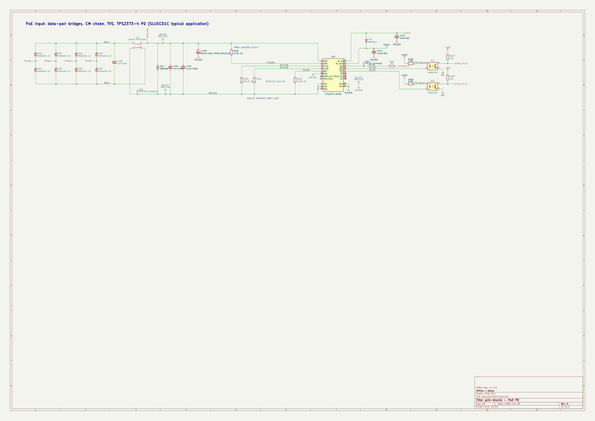

# poe_pd: IEEE 802.3bt PoE powered-device front end

## 1. Status

**Drawn and parity-checked; not yet bench-proven. No compliance certification (IEEE 802.3bt,
safety or EMC) is claimed.**

The drawing was reviewed at GATE 3 as part of wallnode-amp rev A, and that board hasn't been built
yet. Treat every value here as a reviewed design, not a measured one, until [BRINGUP.md](BRINGUP.md)
has rows.

One difference from that drawing: the block is strapped for Class 8 (R102 90.9R), where wallnode-amp
rev A is still strapped for Class 6 (249R).

## 2. What it is

The PD side of a PoE port, from the magnetics' centre taps to the DC-DC converter's input:

- two full bridges of PDS5100 Schottky diodes (D50-D57), one per pair set, so both 2-pair and
  4-pair PSEs work;
- an input common-mode choke (Würth 744272251, L10) with 1 nF caps either side, an SMBJ58A TVS (D10)
  and 0.1 uF across VDD-VSS;
- a TPS2373-4 (U10) for detection (24.9k), classification and the internal hot-swap FET. It's
  strapped for **Class 8**, the 802.3bt maximum: RCLSA (R101) 63.4R and RCLSB (R102) 90.9R give
  62-71 W at the PD after 5 class events (SLUSCD1C Table 1 p18). At 71 W the RTN current is about
  1.7 A from a 42 V port, inside the 1.85 A RTN rating (p6); the choke (2.8 A) and the PDS5100s
  (5 A) have room. A board that wants less fits a bigger RCLSB from the same table (249R = Class 6);
- the VC_IN/VC_OUT bias (D11, C103, C104), and PG held through 0R (R104) to the converter's
  soft-start;
- TPH and TPL carried across the isolation barrier by two FOD817AS optocouplers (U11, U12), with
  10k pull-ups to the isolated 3.3 V;
- two test points on the primary side, TP40 (POE_VSS) and TP41 (PD_PG), which aren't in the BOM.



The design is TI's PMP20878 PD stage (TIDRRG3B sheet 2) with the deviations listed in section 5.

## 3. Interface

| Port | On the sheet | Direction | Rating | Source |
|---|---|---|---|---|
| PR12, PR36, PR45, PR78 | hierarchical label | in | Magnetics centre taps, 0 to 57 V DC between pair sets | IEEE 802.3bt PSE range; SLUSCD1C 8.2.2.1 p33 |
| POE_VDD | hierarchical label | out | Rectified PoE, 0 to 57 V; up to 71.3 W at the PD at Class 8 (a Type 4 PSE), less when the PSE grants less (section 4) | SLUSCD1C p1; Table 1 p18 |
| PRI_RTN | power symbol (global) | out | The switched return after the hot-swap FET; 1.85 A max RTN current | SLUSCD1C p6 |
| VCIN | hierarchical label | in | The converter's bias winding into VC_IN (D11 also feeds VC_OUT from it) | SLUSCD1C 8.2.2.8 p35 |
| VCOUT | power symbol (global) | out | VC_OUT, the bias supply for the converter's controller (about 10-13 V); also drives the opto LEDs | SLUSCD1C p4, 8.2.2.8 p35 |
| CONV_SS | hierarchical label | out | PG through 0R: holds the converter's soft-start low until the hot-swap FET is on | PMP20878 R66 |
| POE_TPH_N, POE_TPL_N | hierarchical label | out | Open collector on the isolated side, 10k to +3V3. Each follows its TPS2373 pin: TPx low turns the opto LED on and pulls POE_TPx_N low. The code table is in section 4 | SLUSCD1C Tables 2-3 p19, 8.2.2.7 p34 |
| +3V3, GND | power symbol (global) | in | The isolated (secondary) logic supply and ground for the opto outputs | |

The primary side (POE_VDD, POE_VSS, PRI_RTN, VCOUT) is isolated from the secondary (+3V3, GND,
POE_TPx_N) only through the optocouplers (FOD817, 5000 Vrms UL1577). The 1500 Vrms barrier itself
is the board's job: creepage and clearance at layout.

On a board, the power symbols join the board's own nets of the same name, so a board that calls its
3.3 V rail something else renames them.

## 4. Power negotiation (firmware rules)

The block asks for Class 8, but the switch decides what it gets. Whatever reads POE_TPH_N and
POE_TPL_N (an ESP32 on wallnode-amp) has to follow these rules, because nothing in the hardware
stops the converter drawing more than the grant.

### What the switch granted: TPH/TPL

For a Class 8 PD, from SLUSCD1C Table 2 (granted) and Table 3 (demoted), p19. L means the pin is
low; POE_TPx_N reads the same as its TPx pin.

| TPH | TPL | Granted at the PD | When |
|---|---|---|---|
| L | L | 71.3 W (Table 2 rounds it to 71 W) | Type 4 PSE, 5 class events: Class 8 granted |
| L | H | 51 W | Demoted to 4 events: a Type 3 PSE, or a Type 4 short of budget |
| H | L | 25.5 W | 2-3 events: an 802.3at (Type 2) PSE, or demoted to 25.5 W |
| H | H | 12.95 W | 1 event: a Type 1 PSE, or demoted to 12.95 W. Also what the pins read before they're enabled and when they're off (below) |

BT isn't carried across the barrier. It only tells a Type 3-4 PSE from a Type 1-2 one, and the
power is the same either way.

The outputs come on 20-28 ms after VC_IN goes high (p8; typically 24 ms, p19). They go back to
high impedance (H/H here) on thermal shutdown, when VC_OUT falls below its UVLO, or when VDD-VSS
drops below about 32 V, and come back with the same code afterwards (p19). So H/H can mean "not
known yet", and the firmware treats it as the lowest grant.

Firmware rule:
1. Boot with the amp muted, or with its limiter at the idle tier.
2. Read POE_TPH_N and POE_TPL_N, twice a few milliseconds apart, and use the code only when both
   reads agree.
3. Set the amp limiter so the whole board stays under the granted power (minus the board's own
   draw, converter losses included), then unmute (after the stagger below).
4. Keep watching the pins. If the code drops, cut the limiter at once; if it rises, ramp up.

### Asking for less, then more: LLDP

After boot, the ESP32 uses 802.3bt Data Link Layer classification (LLDP) to ask the switch for
only what it needs, for example the idle tier, and asks again for more, up to the Class 8 ceiling,
when the music needs it. That frees switch budget for the other ports.

Checked against IEEE 802.3bt task force text (the published IEEE 802.3 standard itself is
paywalled and wasn't read):
- The request goes in the IEEE 802.3 Power via MDI TLV (an LLDP TLV, IEEE 802.3 Clause 79): the
  PD sends "PD requested power value" and the switch answers with "PSE allocated power value". Both
  are the maximum average input power at the PD's connector, in 0.1 W steps
  ([LLDP ad hoc baseline, 79.3.2.5-79.3.2.6](https://grouper.ieee.org/groups/802/3/bt/public/lldpadhoc/Baseline_for_review-LLDP_adhoc_Rev001.pdf)).
- Once DLL classification succeeds it takes precedence over the hardware class, and the assigned
  class follows the allocated value (621-999, that is 62.1-99.9 W, is Class 8). But "the Physical
  Layer classification of the PD is the maximum power that the PD draws across all output voltages
  and operational modes" ([yseboodt_05_0916](https://www.ieee802.org/3/bt/public/sep16/yseboodt_05_0916_dllclasschange.pdf),
  33.2.7). So the hardware Class 8 is the ceiling: LLDP can lower the grant and raise it again up
  to 71.3 W, never above it.

Firmware rule:
1. Lower the amp limiter first, then send the lower request.
2. To go up, send the request and raise the limiter only after the switch's PSE allocated power
   value comes back at the new figure. Never above the TPH/TPL grant.
3. TPH/TPL don't change with LLDP: they show the hardware grant only. The firmware keeps the LLDP
   allocation itself and limits to the smaller of the two.
4. If LLDP never answers, the hardware grant is all there is.

This needs a managed switch that supports 802.3bt LLDP power (Power via MDI). An unmanaged switch
gets the hardware class only: TPH/TPL is the whole story, and the switch usually reserves the full class
for the port. ESP-IDF has no LLDP power agent that we know of, so the firmware sends and parses the
LLDPDUs itself (EtherType 0x88CC).

### Startup stagger

After a power cut or a switch reboot every node starts at once. So, after boot, a node doesn't
take power all at once:
1. It waits a delay worked out from its own MAC address (for example a hash of the MAC, modulo a
   few seconds in fixed steps): different on every node, and the same every time on one node. It
   waits before unmuting and before asking for more power over LLDP.
2. Then it ramps the amp limiter up gradually to the grant, rather than jumping to full, so the
   switch and the other nodes can adjust. Raises over LLDP go up in steps the same way. (Jeff
   prefers the ramp to a single step.)

Many managed switches already power their ports one after another, with a per-port power-up
delay. The node's own stagger comes on top of that; it doesn't replace it.

## 5. Sources and licence check

| Source | What was used | Terms |
|---|---|---|
| TI SLUSCD1C, TPS2373 datasheet, Rev C (Nov 2018) | Pinout, detection/class/REF resistors, TVS, VC caps, TPx opto drive | TI Important Notice (last updated 10/2025, printed on the datasheet's last page): "TI grants you permission to use these resources only for development of an application that uses the TI products described in the resource. Other reproduction and display of these resources is prohibited." This block uses the TPS2373-4 and reproduces none of TI's documents. Read 2026-11-11. |
| TI PMP20878 (TIDRRG3B schematic, TIDUDB0 test report), TPS2373-4 Class 8 reference | Topology and values of the PD stage (input filter, bulk, bias, PG to SS) | Same notice. Values and topology were reused in an original drawing; TI's design files aren't redistributed here. |
| TI TIDA-050023 (TIDUEL2) | Opto feedback practice (FOD817) | Same notice; nothing copied. |
| IEEE 802.3bt task force public documents (LLDP ad hoc baseline Rev001; yseboodt_05_0916) | The LLDP power rules in section 4 | Read and summarised in our own words, with short quotes; nothing copied. Read 2026-11-12. |
| KiCad 10 stock symbols and footprints (Device, Isolator, Connector, power; Diode_SMD, Capacitor_SMD, Resistor_SMD, Inductor_SMD, Package_DIP, TestPoint) | Symbols and footprints | CC-BY-SA-4.0 with KiCad's exception: designs that use the libraries aren't bound by the licence. |
| `pcb-blocks:TPS2373-4` symbol, `pcb-blocks:TI_RGW0020B_VQFN-20-1EP_5x5mm_P0.65mm_EP2.2x2.2mm_ThermalVias` footprint | Drawn for wallnode-amp from SLUSCD1C p4 and TI drawing 4222816/A | Original work, CERN-OHL-P-2.0 with the rest of this repo. Its 3D model is KiCad's stock Texas_RGW0020A STEP. |

Deviations from PMP20878, from the wallnode-amp design notes:
- The auxiliary adapter input (APD divider, ADPT circuit) is left out. APD is tied to RTN, as the pin
  table says for an unused APD.
- AMPS_CTL and MPS_DUTY are open (automatic MPS off): the converter's idle draw is far above the MPS
  minimum. UVLO_SEL and /BT are open as well.
- TPH/TPL drive two optocouplers instead of LEDs (SLUSCD1C 8.2.2.7). LED current is 1.55-2.11 mA at
  VC 10-13 V (under the 3 mA recommendation), and the 10k pull-up needs CTR >= 19% at 1.5 mA; FOD817A
  is 80-160%.
- D11 is an MMDL914 in place of PMP's BAS316, whose datasheet couldn't be obtained.

Known open points, carried from the GATE 3 review (not errata, since nothing has been measured):
- The primary MLCCs are 100 V parts on a 57 V rail, 1.75x, below a 2x derating rule. That's as in
  TI's reference.
- The SMDIP-4_W9.53mm footprint still has to be checked against onsemi case 709AH, and the opto
  creepage at layout.

## 6. Proven on

Not yet. The first board is **wallnode-amp rev A** (Ion-Speakers), not built yet. When it's
measured, this section gets the board and rev, a link to the bring-up data in
[BRINGUP.md](BRINGUP.md), the load it was tested at, and any errata.

## 7. Using it

1. In KiCad 10, place `poe_pd` from the Design Blocks panel (library `pcb-blocks`) as a sheet
   named `PoE PD`. The kit's installer registers the library; without the kit, add
   `pcb-blocks.kicad_blocks` to the design-block library table, and `lib/pcb-blocks.kicad_sym` and
   `lib/pcb-blocks.pretty` to the symbol and footprint tables.
2. Copy `src/blocks/poe_pd.py` into the board's `src/blocks/`. Its first line is
   `# from pcb-blocks <tag or main> (<commit>)`. Add a SOURCES.md line with the repo URL and commit.
3. Call `poe_pd(...)` from the board's `board()` with the board's nets. KiCad re-annotates the
   placed sheet, so set `ref=` in the copy to match, or let the parity report list what to change.
4. Run `pcb-skidl.ps1 <board> -Sheet "PoE PD"` until it reports 0 differences.

The converter, the magnetics and the 1500 Vrms barrier are the board's.

## 8. Parity

`tools\check-blocks.ps1` on the `poe-pd` branch, 2026-11-12, after the Class 8 change (skidl 3.0.0, KiCad 10.0.6):

```
--- poe_pd
  Python: 31 parts, 25 nets (+0 unconnected pins)   schematic: 31 parts, 25 nets (+5 unconnected pins)
  differences: 0
  nets with the same pins but a different name (not a difference): 12
  Parity: 0 differences.
poe_pd: parity 0, design block identical
All 1 block(s) pass.
```

The 12 renamed nets are the local nets inside the sheet, which KiCad prefixes with `/PoE PD/`.
The 5 unconnected pins are U10's four unused pins and pin 20 (NC), all with no-connect flags.

`kicad-cli sch erc` on the block project: 0 errors and 2 warnings, both for CONV_SS having only one
pin inside the block (it goes to the converter on a board).
